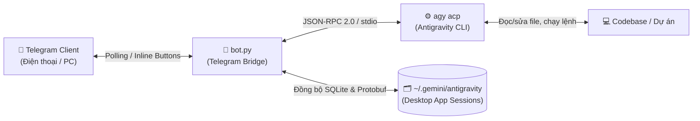

# 🚀 TeleGravity — Antigravity Telegram Bridge (`agy acp`)

🌐 **Ngôn ngữ / Languages**: **🇻🇳 Tiếng Việt** · [🇬🇧 English](docs/i18n/README.en.md) · [🇫🇷 Français](docs/i18n/README.fr.md) · [🇯🇵 日本語](docs/i18n/README.ja.md) · [🇰🇷 한국어](docs/i18n/README.ko.md) · [🇨🇳 中文](docs/i18n/README.zh.md) · [🇷🇺 Русский](docs/i18n/README.ru.md) · [🇩🇪 Deutsch](docs/i18n/README.de.md) · [🇪🇸 Español](docs/i18n/README.es.md)

[](https://www.python.org/)
[](#)
[](LICENSE)

## 🌍 Mô Tả Dự Án (Multilingual Description)

- 🇻🇳 **Tiếng Việt**: **Điều khiển Google Antigravity từ xa 24/7 qua Telegram** — Đồng bộ trực tiếp phiên làm việc 2 chiều với ứng dụng Antigravity trên máy tính (macOS / Windows / Linux) hoặc vận hành độc lập trên Cloud VPS, **không cần API Key**.
- 🇬🇧 **English**: **Control Google Antigravity remotely 24/7 via Telegram** — Seamlessly sync sessions two-way with the Antigravity Desktop App (macOS / Windows / Linux) or run standalone on a Cloud VPS, **with no API Key required**. ([Read full English guide →](docs/i18n/README.en.md))
- 🇫🇷 **Français**: **Contrôlez Google Antigravity à distance 24h/24 et 7j/7 via Telegram** — Synchronisation bidirectionnelle transparente des sessions avec l'application de bureau Antigravity (macOS / Windows / Linux) ou exécution autonome sur un VPS Cloud, **sans clé API requise**. ([Lire le guide en français →](docs/i18n/README.fr.md))
- 🇯🇵 **日本語**: **Telegram から 24時間365日 Google Antigravity をリモート操作** — デスクトップ版 Antigravity アプリ（macOS / Windows / Linux）との双方向セッション同期、およびクラウド VPS での24時間稼働に対応。**API キーは不要です。** ([日本語ガイドを読む →](docs/i18n/README.ja.md))
- 🇰🇷 **한국어**: **텔레그램을 통해 연중무휴 24시간 Google Antigravity를 원격 제어하세요** — 데스크톱 Antigravity 앱(macOS / Windows / Linux)과 실시간 양방향 세션 동기화를 지원하며, 클라우드 VPS에서도 **별도의 API 키 없이** 24시간 구동할 수 있습니다. ([한국어 가이드 보기 →](docs/i18n/README.ko.md))
- 🇨🇳 **中文**: **通过 Telegram 全天候 24/7 远程控制 Google Antigravity** — 与桌面端 Antigravity 应用（macOS / Windows / Linux）无缝双向同步会话，或独立部署在云端 VPS 上，**无需任何 API Key**。([阅读中文指南 →](docs/i18n/README.zh.md))
- 🇷🇺 **Русский**: **Удаленное управление Google Antigravity 24/7 через Telegram** — Двусторонняя синхронизация сессий с настольным приложением Antigravity (macOS / Windows / Linux) или автономная работа на облачном VPS **без необходимости использования API-ключа**. ([Читать руководство на русском →](docs/i18n/README.ru.md))
- 🇩🇪 **Deutsch**: **Steuern Sie Google Antigravity 24/7 aus der Ferne über Telegram** — Nahtlose bidirektionale Sitzungssynchronisierung mit der Antigravity Desktop-App (macOS / Windows / Linux) oder eigenständiger Betrieb auf einem Cloud-VPS, **ganz ohne API-Schlüssel**. ([Deutsche Anleitung lesen →](docs/i18n/README.de.md))
- 🇪🇸 **Español**: **Controla Google Antigravity de forma remota 24/7 a través de Telegram** — Sincronización bidireccional de sesiones con la aplicación de escritorio Antigravity (macOS / Windows / Linux) o ejecución independiente en un VPS en la nube, **sin necesidad de clave API**. ([Leer guía en español →](docs/i18n/README.es.md))

---

## ✨ Điểm Nổi Bật (Why This Repo?)

1. **🔑 Không tốn tiền API Key**: Giao tiếp trực tiếp với tiến trình `agy acp` (Agent Client Protocol qua `stdio`), sử dụng chính tài khoản Google đã đăng nhập trong Antigravity CLI.
2. **🔄 Đồng bộ Phiên & Dự án 2 chiều với App Máy Tính**:
   - Đang code dở trên **Antigravity Desktop App** → ra ngoài mở Telegram gõ `/sessions` → chọn phiên để làm tiếp trên điện thoại.
   - Tạo hội thoại mới từ Telegram → tự động ánh xạ vào đúng **Project** trên App máy tính (đồng bộ cả SQLite `conversation_summaries.db` lẫn Protobuf cache `agyhub_summaries_proto.pb` / `jetbox_summaries_proto.pb`).
3. **🛡️ Kiểm soát & Duyệt quyền từ xa (Interactive Permission Approval)**:
   - Khi Agent cần chạy lệnh shell (`run_command`) hoặc chạm vào file nhạy cảm, Bot gửi thông báo kèm nút bấm trực tiếp trên Telegram: `✅ Cho phép 1 lần` · `🔓 Luôn cho phép` · `❌ Từ chối` · `⚡ Bật auto-approve`.
4. **📸 Đa phương thức & Đầy đủ tính năng của Antigravity**:
   - Gửi tin nhắn văn bản, gửi **ảnh chụp màn hình kèm caption** để báo lỗi UI/UX.
   - Đổi model (`/model`), đổi chế độ duyệt (`/mode`), chuyển dự án (`/projects`, `/cd`), chuyển tiếp trực tiếp các slash command đặc trưng như `/goal`, `/plan`, `/browser`.
5. **☁️ Đa nền tảng & Sẵn sàng chạy 24/7**:
   - Hỗ trợ **macOS** (`launchd`), **Linux / VPS / WSL2** (`systemd`), và **Windows Native** (`Task Scheduler` qua `service.ps1`).

---

## 🏗️ Kiến Trúc Hoạt Động



---

## ⚡ Bắt Đầu Nhanh (Quick Start)

### Bước 1: Chuẩn bị Bot Telegram & User ID
1. Mở Telegram, nhắn **`@BotFather`** → gửi `/newbot` → lưu lại **`TELEGRAM_BOT_TOKEN`**.
2. Mở Telegram, nhắn **`@userinfobot`** → bấm Start → lưu lại số **`Id`** (dùng làm Whitelist bảo mật).
3. Đảm bảo máy đã cài đặt **Antigravity CLI (`agy`)** và đăng nhập tài khoản Google.

### Bước 2: Cài đặt theo hệ điều hành

#### 🍎 macOS / 🐧 Linux / 🪟 Windows (WSL2)
```bash
git clone https://github.com/phamhuuphucan/TeleGravity.git
cd TeleGravity

# Chạy script cài đặt tự động (tạo .venv, cài thư viện, cấu hình .env)
./setup.sh

# Chạy nền 24/7 tự khởi động cùng hệ thống
./service.sh install
```

#### 🪟 Windows (Chạy trực tiếp bằng PowerShell)
```powershell
git clone https://github.com/phamhuuphucan/TeleGravity.git
cd TeleGravity

# Thiết lập .venv, cài thư viện và tạo file .env
.\service.ps1 setup

# Cài đặt chạy nền tự động qua Windows Task Scheduler
.\service.ps1 install
```

---

## 📚 Hệ Thống Tài Liệu Chi Tiết (`docs/`)

Toàn bộ quy trình từ thiết lập trên máy cá nhân, đồng bộ phiên làm việc với App, đến việc đưa lên VPS chạy 24/7 được biên soạn chi tiết tại thư mục [`docs/`](docs/):

| Tài liệu | Nội dung chính |
| :--- | :--- |
| 📖 **[01. Cài đặt trên Máy tính & Đồng bộ App](docs/01-local-setup-sync.md)** | Hướng dẫn chi tiết cho **macOS, Windows (WSL2 & Native), Linux Desktop**; cách hoạt động độc lập khi tắt App (`Cmd+Q`) và đồng bộ phiên làm việc 2 chiều. |
| ☁️ **[02. Triển khai lên VPS chạy 24/7](docs/02-vps-deployment-24-7.md)** | Quy trình đưa Antigravity CLI + Bot lên **Linux VPS** từ A–Z, cách đăng nhập Google OAuth trên VPS không giao diện (**SSH Port Forwarding**), quản lý `systemd`. |
| 🧠 **[03. Kiến trúc ACP & Cơ chế Đồng bộ](docs/03-architecture-and-sync.md)** | Giải thích kỹ thuật bên dưới `bot.py`: giao thức JSON-RPC 2.0 qua `stdio` của `agy acp` và thuật toán đồng bộ SQLite + Protobuf binary. |
| 🛡️ **[04. Sổ tay Lệnh Telegram & Bảo mật](docs/04-commands-and-security.md)** | Bảng tra cứu toàn bộ lệnh Telegram, các chế độ duyệt quyền (`default`, `accept-edits`, `plan`), cách đổi tài khoản Google và nguyên tắc an toàn. |

---

## 💬 Các Lệnh Telegram Thường Dùng

| Lệnh | Chức năng |
| :--- | :--- |
| *(Tin nhắn văn bản / Ảnh kèm caption)* | Giao việc trực tiếp cho Antigravity Agent |
| `/status` | Xem Workspace, App Project, Phiên hiện tại, Model, Mode |
| `/sessions` | Liệt kê 10 phiên gần nhất (cả trên App & Telegram) → bấm nút để mở lại |
| `/projects` | Liệt kê danh sách các dự án trong `PROJECTS_ROOT` |
| `/cd <TênDựÁn \| ĐườngDẫn>` | Chuyển nhanh sang dự án khác (ví dụ: `/cd WebApp`) |
| `/new` | Bắt đầu phiên hội thoại mới trên workspace hiện tại |
| `/stop` | Dừng ngay lập tức tác vụ Agent đang thực thi |
| `/model [id]` | Xem danh sách model khả dụng hoặc đổi model (Gemini, Claude...) |
| `/mode [default\|accept-edits\|plan]` | Chuyển đổi chế độ kiểm duyệt thao tác của Agent |
| `/auto [on\|off]` | Bật / tắt chế độ tự động duyệt mọi yêu cầu (Auto-approve) |
| `/goal ...`, `/plan ...`, `/browser ...` | Chuyển tiếp trực tiếp các Slash Command của Antigravity cho Agent |

---

## 🗂️ Cấu Trúc Thư Mục Dự Án

```text
.
├── bot.py                 # Mã nguồn chính (ACP Client + Telegram Bot + SQLite/Protobuf Sync)
├── setup.sh               # Script cài đặt nhanh 1 chạm cho macOS / Linux / WSL2
├── service.sh             # Quản lý dịch vụ chạy nền 24/7 (launchd trên macOS / systemd trên Linux)
├── service.ps1            # Quản lý cài đặt & dịch vụ chạy nền trên Windows (PowerShell)
├── requirements.txt       # Các thư viện Python cần thiết
├── .env.example           # File mẫu cấu hình biến môi trường
├── docs/                  # Bộ tài liệu hướng dẫn chi tiết từ cơ bản đến chuyên sâu
├── data/                  # Lưu trạng thái phiên làm việc hiện tại (state.json - tự động tạo)
└── logs/                  # Lưu log hoạt động khi chạy dịch vụ nền (bot.log - tự động tạo)
```

---

## 📄 Giấy Phép (License)

Dự án được phân phối dưới giấy phép [MIT License](LICENSE). Bạn hoàn toàn tự do sử dụng, tùy biến và chia sẻ cho cộng đồng.
