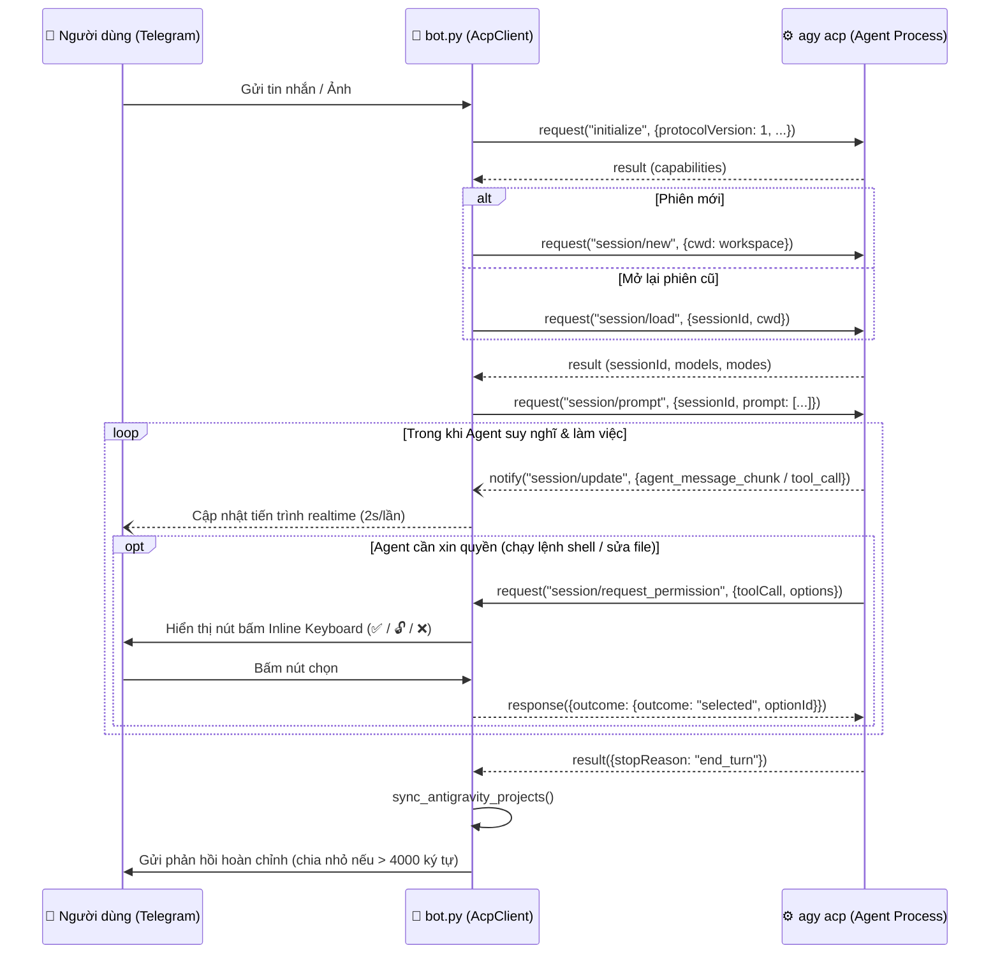

# 03. Kiến Trúc Kỹ Thuật: Giao Thức ACP & Cơ Chế Đồng Bộ Phiên

Tài liệu này giải thích chi tiết cách `bot.py` giao tiếp với lõi của Google Antigravity và cách hệ thống đồng bộ hóa dữ liệu giữa CLI (`agy`) và ứng dụng Desktop (**Antigravity App**).

---

## 1. Giao Thức Agent Client Protocol (ACP) Qua `stdio`

Thay vì gọi REST API thông thường (đòi hỏi API Key tính phí theo token), `bot.py` đóng vai trò là một **ACP Client** chuẩn, khởi chạy tiến trình con:

```bash
agy acp --app-data-dir antigravity
```

### Luồng bản tin JSON-RPC 2.0 (2 chiều qua `stdin` / `stdout`):



---

## 2. Cơ Chế Đồng Bộ Phiên Với Ứng Dụng Antigravity Trên Máy Tính

### Vấn đề gốc của `agy` CLI:
Khi tạo một phiên hội thoại mới qua `agy acp`, CLI mặc định gán `project_id = "default-cli-project"`.
Trong khi đó, ứng dụng **Antigravity Desktop App** quản lý các dự án theo từng UUID riêng trong thư mục `~/.gemini/config/projects/<uuid>.json` và đọc danh sách hội thoại từ cả cơ sở dữ liệu SQLite lẫn các file Protobuf cache. Nếu không đồng bộ, các phiên tạo từ Telegram sẽ không hiện đúng dưới tên dự án trong App máy tính.

### Giải pháp trong `bot.py` (`sync_antigravity_projects`):

Sau khi khởi động bot và sau mỗi lượt chat (`run_turn`), `bot.py` thực hiện quy trình đồng bộ 4 bước:

1. **Ánh xạ Workspace sang Project UUID (`resolve_project_for_workspace`)**:
   - Quét toàn bộ file `~/.gemini/config/projects/*.json` để tìm Project có `folderUri` khớp với `workspace` hiện tại.
   - Nếu `workspace` là một dự án con mới trong `PROJECTS_ROOT` mà chưa từng mở trên App, `bot.py` tự động sinh một `uuid4` mới và tạo file `<uuid>.json` chuẩn cấu trúc của Antigravity App.

2. **Cập nhật SQLite Tổng hợp (`~/.gemini/antigravity/conversation_summaries.db`)**:
   - Đọc bảng `conversation_summaries` và bảng tìm kiếm toàn văn `conversations_fts`.
   - Đổi cột `project_id` từ `default-cli-project` sang `new_pid` (UUID của dự án trên App).
   - Sửa trực tiếp trường Protobuf số 18 (`wire tag 0x92 0x01 + varint length + utf8 bytes`) bên trong cột nhị phân `raw_summary` bằng hàm `_replace_proto_project_id()`.

3. **Cập nhật SQLite Chi tiết của từng phiên (`~/.gemini/antigravity/conversations/<session_id>.db`)**:
   - Cập nhật blob nhị phân trong bảng `trajectory_metadata_blob` để đồng nhất `project_id` bên trong metadata của phiên.

4. **Tái tạo File Cache Protobuf (`agyhub_summaries_proto.pb` & `jetbox_summaries_proto.pb`)**:
   - Đọc toàn bộ `raw_summary` mới nhất theo thứ tự `last_modified_time DESC`, đóng gói lại theo chuẩn length-delimited Protobuf (`0x0a + varint_len + blob`) và ghi nguyên tử (atomic write qua file `.pb.tmp`) vào 2 file `.pb`.
   - Nhờ bước này, giao diện **Agent Manager / Conversation History** trên ứng dụng Antigravity nhận diện ngay lập tức phiên làm việc vừa diễn ra trên Telegram!
